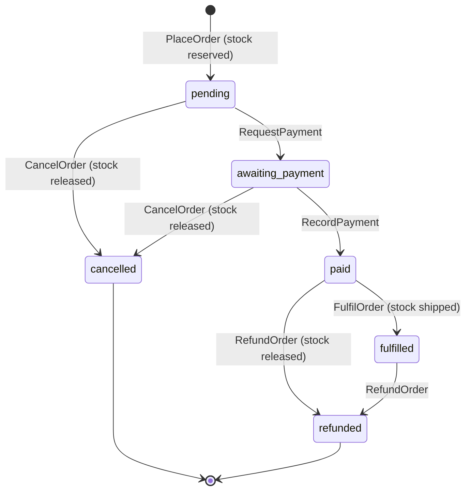

# Order state machine

An order's status changes only through `OrderStatus::transitionTo()`, applied by
`OrderTransitions`. Any move not drawn below is refused with
`409 illegal-transition`. The response lists the transitions that are allowed
from the current status.
`OrderStatusTest` checks every (from, to) pair against this diagram.

| Status | Stock | Shipping address | Reached by | Event |
|---|---|---|---|---|
| `pending` | reserved | editable | `POST /orders` | `orders.order_placed` |
| `awaiting_payment` | reserved | editable | `RequestPayment` (Payments, Phase 6) | — |
| `paid` | reserved | editable | `RecordPayment` (Payments, Phase 6) | `orders.order_paid` |
| `fulfilled` | shipped (left on-hand) | locked | `POST /orders/{id}/fulfil` | `orders.order_fulfilled` |
| `cancelled` | released | locked | `POST /orders/{id}/cancel` | `orders.order_cancelled` |
| `refunded` | released if it had not shipped | locked | `RefundOrder` (Payments, Phase 6) | `orders.order_refunded` |

Rules that follow from the diagram:

- **Only an unpaid order can be cancelled.** Once money has moved, the way out
  is a refund, so the ledger always has a matching entry.
- **Only a paid order ships.**
- **A refund after shipping does not restock.** The goods are with the customer.
  If they come back, they are received with a `returned` stock adjustment.
- `cancelled` and `refunded` are final.

## Every transition is atomic

Each transition runs in one transaction that does all of the following:

- locks the order row (`FOR UPDATE`),
- checks `If-Match`,
- applies the rule,
- bumps `version`,
- appends to the append-only `order_events` history,
- performs the transition's stock movement.

Either all of it commits or none of it does. The domain event is dispatched
after commit.

## Optimistic locking

Every order response carries `ETag: "<version>"`. A client that sends it back as
`If-Match` on cancel, fulfil or a shipping-address change gets its write only if
nobody changed the order in between. Otherwise it gets `412 precondition-failed`
with `current_version`.

The roadmap suggests `409 stale-version` for this case. We return 412, as the
catalog already does (ADR 0006). 412 is the status HTTP defines for a failed
`If-Match`, and one response for one condition across the API is worth more
than matching the plan's wording. A malformed `If-Match` is a 400. No `If-Match`
means last write wins.
